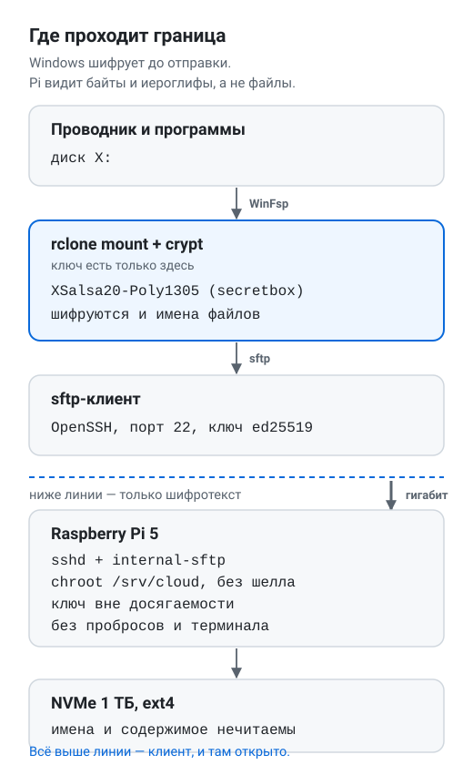

# Сквозное шифрование: SSD на Raspberry Pi как диск Windows

**Сетевой диск со сквозным шифрованием: SSD живёт на Raspberry Pi, буква `X:` появляется в проводнике Windows, а сама Pi не может прочитать ни одного вашего файла.**

Данные шифруются **на Windows, до отправки**. На Pi приезжают уже зашифрованные блоки с зашифрованными именами. Ключ есть только на клиенте — отсюда «E2E», end-to-end: расшифровать может только та сторона, которая записала.

---

## Главное в семи строках

1. Три слоя, каждый решает своё: **транспорт** (OpenSSH, `internal-sftp`, пользователь заперт в каталоге) · **шифрование** (`rclone crypt`: XSalsa20-Poly1305, имена файлов тоже) · **представление** (`rclone mount` + WinFsp → обычная буква диска).
2. На Pi нет серверной программы вообще — только штатный OpenSSH. Ни Samba, ни NFS, ни веб-панели, ни самого rclone. Меньше кода слушает сеть — меньше есть что ломать.
3. Шифрование бесплатно по скорости: голый SSH 103–113 МБ/с, с crypt 99–105 МиБ/с. Узкое место — гигабитный кабель, а не криптография.
4. Диск на Pi умеет 430–460 МБ/с и простаивает вчетверо. Апгрейд SSD бессмыслен, апгрейд сети — нет.
5. Мелкие файлы — слабое место: ≈200 файлов/с при 8 потоках. Распаковывайте архивы локально, а не на `X:`.
6. E2E закрывает от чужого глаза, но не от потери: **резервной копии нет**, а без пароля `crypt` данные не восстановит никто.
7. Периметр Pi в описанной конфигурации открыт: нет firewall, вход по паролю для основного пользователя разрешён. За пределы доверенной сети так выносить нельзя — [§15](docs/5-hardening/15-perimeter.md).

---

## Что это даёт

Обычный диск `X:` в проводнике. Копируете туда файлы — они уезжают на SSD, воткнутый в Raspberry Pi под столом. Разница с любым сетевым диском в одном: **хранилище не знает, что хранит**.

Украли Pi, вынули SSD, получили доступ к машине по SSH — увидят каталог из нечитаемых имён и потоки байт без структуры. Видны только метаданные: сколько файлов, какого размера, когда менялись.

Сервер не видит содержимое, но и клиент не видит проблем: для программ это обычная буква диска, с локальным кэшем и отложенной записью.

---

## Структура

Разбор разбит на пять частей. README — только вход; установка, обоснования и цифры — в `docs/`.

| Часть | Что внутри | Разделы |
|---|---|---|
| **[Установка](docs/1-install/README.md)** | Pi: система, диск, пользователь, доступ по ключу. Windows: WinFsp, rclone, монтирование, автозапуск, приёмка | [§1–§5](docs/1-install/README.md) |
| **[Шифрование](docs/2-crypto/README.md)** | Границы слоёв, формат файла rclone, проверка руками, чего E2E **не** защищает | [§6–§9](docs/2-crypto/README.md) |
| **[Скорость](docs/3-perf/README.md)** | Замеры по слоям, арифметика узких мест, почему мелкие файлы медленные | [§10–§11](docs/3-perf/README.md) |
| **[Эксплуатация](docs/4-ops/README.md)** | Повседневные правила, таблица отказов, риски и восстановление | [§12–§14](docs/4-ops/README.md) |
| **[Надёжность](docs/5-hardening/README.md)** | Периметр, наблюдение, бэкап шифротекста, честный список пробелов | [§15–§18](docs/5-hardening/README.md) |

Полное оглавление с описаниями — в [docs/README.md](docs/README.md). Источники — в [docs/references.md](docs/references.md). Сценарий для автоматического развёртывания — в [AGENTS.md](AGENTS.md).

> [!TIP]
> Если нужен только рабочий диск — читайте [§1](docs/1-install/01-pi.md)…[§5](docs/1-install/05-acceptance.md). Если нужно понять, почему это безопасно и где кончается защита — [§6](docs/2-crypto/06-layers.md)…[§9](docs/2-crypto/09-limits.md). Остальное — на потом.

---

## На чём это собрано

Все цифры в разборе сняты с одной конкретной конфигурации, а не взяты из спецификаций.

| | |
|---|---|
| Одноплатник | Raspberry Pi 5 Model B Rev 1.1, 2 ГБ ОЗУ |
| Система | Debian 13 (trixie), ядро 6.18.34, aarch64 |
| SSH | OpenSSH 10.0p2 |
| Диск | NVMe 1 ТБ (HS-SSD-FUTURE 1024G), 953.9 ГБ полезных |
| Шина диска | PCIe 5 GT/s ×1 (Gen 2 ×1) — штатный режим Pi 5 без правки конфига |
| Файловая система | ext4, GPT, блок 4096 Б, резерв под root снят (`-m 0`) |
| Сеть | eth0, 1000 Мбит/с, полный дуплекс, задержка в локальной сети 2 мс |
| Клиент | Windows 11 Pro 25H2 |
| rclone / WinFsp | v1.75.0 / 2.1.25156 |
| Занято на момент замеров | 207 ГБ из 938 ГБ (23 %) |

---

## Границы и дисклеймер

> [!WARNING]
> **Это не резервная копия.** Один SSD, без зеркала и без выгрузки. Шифрование защищает от чужих глаз, но не от смерти диска, не от случайного удаления и не от шифровальщика на клиенте. Копия шифротекста делается отдельно и без ключей — [§17](docs/5-hardening/17-backup.md).

> [!CAUTION]
> **Потеря паролей `crypt` = потеря данных.** Пароль превращается в ключ через scrypt, содержимое закрыто XSalsa20-Poly1305. Ни разработчики rclone, ни перебор не помогут. Оба пароля (основной и соль) записываются на бумагу и хранятся отдельно от компьютера — [§14](docs/4-ops/14-recovery.md).

> [!NOTE]
> «E2E» здесь означает ровно то, что написано: данные зашифрованы на клиенте и на сервере лежат шифротекстом. Кэш на `C:`, файл `rclone.conf` и журнал монтирования — это клиентская сторона, и она открыта. Что именно это меняет — [§9](docs/2-crypto/09-limits.md).

---

## Лицензия

[MIT](LICENSE): берите, меняйте, используйте. Ссылка на репозиторий приветствуется, но не требуется.

Схема в `assets/` — часть этого же разбора.

Репозиторий: [god4claw/E2E-ssd-pi-to-win](https://github.com/god4claw/E2E-ssd-pi-to-win) · Вопросы и правки — через issue или PR.
